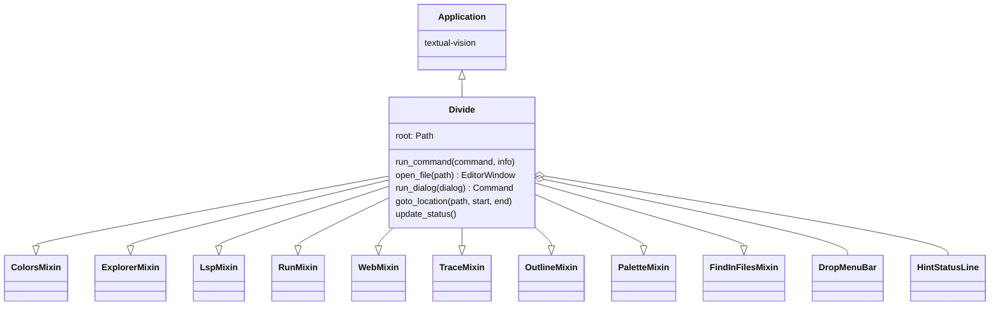
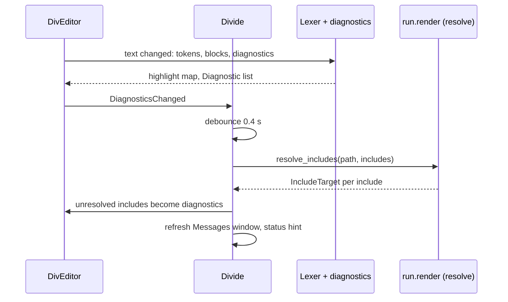
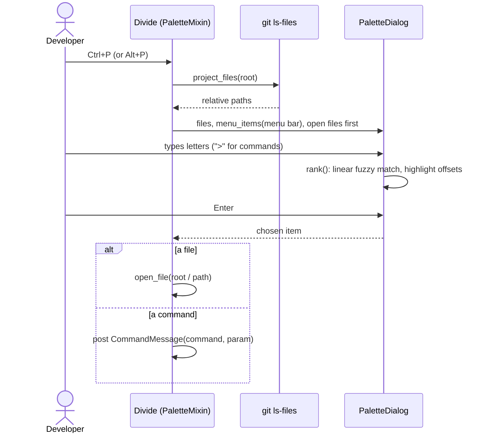
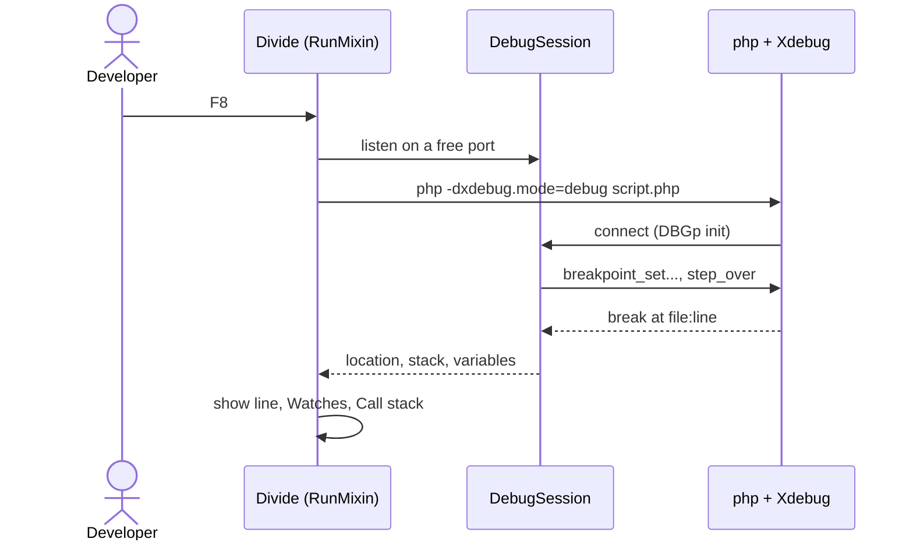

# Design Model

The design of each subsystem: its main classes, what they are responsible
for, and how they collaborate in the key scenarios. Module docstrings hold
the finer detail, and this document points to them.

## 1. Application shell (`divide.app`)



- **`Divide`** builds the menu bar (`init_menu_bar`) and the status line,
  binds the keys (`BINDINGS` → `action_command(name)` → `CommandMessage`) and
  dispatches every command in `run_command`, a worker. It owns the window
  layout (editors, the project window on the left, list windows at the
  bottom or on the right) and the links between editors and services:
  include resolution, checks, the Messages window and the status hint.
- **`DropMenuBar`** makes F10 open the first menu with the focus in it.
- **`HintStatusLine`** adds a context hint and a spinner for background work
  (`busy(label)` context manager).
- **Mixins** (one per feature module in `divide.ui`) add the feature's
  commands and state to the app.

## 2. Windows and dialogs (`divide.ui`)

| Class | Module | Responsibility |
|---|---|---|
| `_TVWindow` | windows | Base window: frame, layers, frame scroll bars synced with the largest scrolling child. |
| `EditorWindow` / `EditorView` | windows | A file in a `DivEditor`, its path, dirty flag and indicator (`line:col`). |
| `ProjectWindow` / `ProjectTree` | windows | The project folder as a tree. Hidden folders, file marks, a click to select, a double click to open. |
| `LocationsWindow` | windows | A list of lines, each possibly a place in a file. Enter jumps there. Base of `MessagesWindow` and `FindResultsWindow`. |
| `OutputWindow` | windows | The output of a render or a script. |
| `DialogScreen`, `_Dialog` | dialogs | Modal dialogs over the desktop, Turbo Vision default-button behaviour, input histories remembered on OK. |
| `FileDialog`, `SearchDialog`, `GotoLineDialog`, `InputDialog`, `MessageBox` | dialogs | The standard dialogs. |
| `HistoryInput`, `HistoryList` | history | THistory: input lines with their earlier entries. |
| `PaletteDialog`, `PaletteList` | palette | Go to file and the command palette (one dialog, `>` switches modes). |
| `FindInFilesDialog`, `FindResultsWindow` | findfiles | Find in files and its results. |
| `OutlineWindow` | outline | The outline of the active PHP file or template. |
| `HelpWindow`, `HelpView` | help | Help topics in Borland's help colours. |
| `JsonTreeWindow` | jsontree | Tree editor over a Div JSON buffer. |
| `DialectorWindow` and its dialogs | dialector | The dialect assistant over a `.dialect` buffer. |
| `TraceWindow` | tracer | The render trace. |
| `WatchesWindow`, `CallStackWindow` | runner | Debugger windows. |
| `ServerLogWindow`, `WebServerDialog` | webserver | The built-in web server. |
| `ProgressDialog` | progress | The box shown while a job runs, with its verdict. |
| `ColorsDialog` | colors | Theme and colour depth, with a live preview. |
| `CompletionPopup`, `InfoPopup` | completion | The completion list and signature/hover popups. They never take the focus. |
| `ShadowScreen` | shadow | Turbo Vision drop shadows, applied by a compositor. |

## 3. Editor (`divide.editor`)

- **`DivEditor`** (a Textual `TextArea`) knows its language (`lang`) and, for
  templates, its dialect. It builds the highlight map with divide's lexers
  (`_LexerCache` keyed by text and dialect) or with tree-sitter for PHP. It
  holds diagnostics and paints them, exposes `div_blocks()` for the outline,
  posts `DiagnosticsChanged`, and repaints itself when the theme changes.
- **`search`**: `SearchOptions`, `compile_pattern`, `find`, `replace_all`.
  Find, Replace and Find in files all use them.

## 4. Languages (`divide.lang`)

- **`lang.Language`**: name, extensions, help topic, and whether divide
  checks it. `LANGUAGES = (DIV, JSON, PHP)`.
- **`lang.div.dialect.Dialect`**: the `DIV_TAG_*` values, with defaults from
  `div.php`. `template_properties` reads `@_DIALECT` and others.
- **`lang.div.lexer.Lexer`**: produces `Token(kind, start, end)` and
  `Block(kind, start, head, end)` from a template and a dialect, mirroring
  Div's matching rules (see [div-language.md](div-language.md)).
- **`lang.div.diagnostics`**: `Diagnostic` items from the tokens and the
  text.
- **`lang.div.complete`**: `complete()` looks at the text before the cursor
  and returns a `CompletionResult` (variables from the data file in scope,
  loop item fields, include paths, snippets).
- **`lang.div.outline`**: `outline(text, blocks)` returns nested `Entry`
  items.
- **`lang.div.dialector`**: dialect sections, examples and differences.
- **`lang.divjson`**: tokens, parser (with references and comments) and
  writer for Div JSON.
- **`lang.treesitter`**: `GRAMMARS` (language → tree-sitter package), `grammar(lang)` returns the
  Language and Textual's highlight query (the package's own as fallback) with its captures
  renamed `@ts.*` by `prefixed()`; `DivEditor` registers it as `divide-<lang>`.
- **`lang.plain`**: `ini_tokens()` and `csv_tokens()` (each column in one of six colours in turn,
  quoted fields, the separator guessed from the first line).
- **`lang.php`**: the tree-sitter grammar (`grammar()`), `lint()` with
  `php -l`, and `outline()` returning `Symbol` items.

## 5. Running PHP (`divide.run`)

| Class / function | Responsibility |
|---|---|
| `render.render()` → `RenderResult` | Render through `bridge.php` with the editor's text, the template's real path and the data. `RenderMessage` holds the warnings and fatal errors. |
| `render.resolve_includes()` → `IncludeTarget` | Where Div would take each include. |
| `render.check_dialect()` / `load_dialect()` / `translate_template()` | Dialect validation, loading and translation by Div. |
| `script.run_script()` → `ScriptResult` | `php script.php args`, with stdout and stderr captured separately. PHP's errors are parsed into `ScriptMessage` items. |
| `server.WebServer` | `php -S`, its log, and Xdebug connections per request. |
| `dbgp.DebugSession` | Xdebug over DBGp: breakpoints, run and step, `Frame`, `Variable`, eval. |
| `trace.RenderTrace` | A traced render: `Mutation` and `Event` items in order. |
| `bridge.php` | The PHP side of everything above: one JSON request, one JSON reply. |

## 6. Language servers (`divide.lsp`)

- **`lsp.ServerSpec`** / `SERVERS`: the known servers (phpactor,
  intelephense) and how to find their commands.
- **`lsp.client.LspSession`**: one server for one project, on pygls. It
  sends initialize, open/change/save/close (the whole text), completion,
  hover and definition. Diagnostics arrive through a callback.
- **`ui.lsp.LspMixin`**: starts servers on demand, syncs documents
  (debounced), merges server diagnostics with divide's own, and fills the
  completion list.

## 7. Help (`divide.manual`)

`Book` items come from `books.json`. Markdown pages are turned into `Topic`
items (lines of `Span`, with `Link` cross references) by `_Writer`. Books are
copied from their sources by `tools/sync_book.py`, so documentation is
written once, in its own repository.

**Full-text search (`divide.manual.fulltext`).** `sections(name)` splits a
page into its opening and its `#`-`###` sections, as plain words. `build()`
writes them to `search.sqlite` in two FTS5 tables with the same rowids:
`help` (Porter stemming) and `help_raw` (words as written). A `meta` table
holds the pages' `fingerprint()`. `connection()` uses the shipped file when
the fingerprint matches, else an in-memory index built on the spot.
`search(text)` matches finished words in `help` and the last word as a prefix
in either table, sums the BM25 ranks (title 8, heading 4, text 1), falls back
to any word when no section has all of them, and returns `Hit` items (target
`book:Page#anchor`, title, heading, a snippet with the words marked).
`ui.helpsearch.HelpSearchDialog` shows them live as the developer types.

## 8. Interface languages (`divide.i18n`)

Texts are written in English and marked `_("...")`, or `ngettext(singular,
plural, n)` for plurals, with `{named}` placeholders filled by
`.format()`. `i18n` picks the language once, at import (`DIVIDE_LANGUAGE`,
then `--language` read from `sys.argv`, then the config's `language`, then
`LANGUAGE` / `LC_ALL` / `LC_MESSAGES` / `LANG`) and loads
`locale/<lang>/LC_MESSAGES/divide.mo`, or uses English when there is none.
`ui.language.LanguageDialog` (Options > Language) writes the config's choice.
`tools/i18n.py` extracts `locale/divide.pot`, merges it into each
`divide.po` and compiles the `.mo` files with Babel. `tools/i18n_mark.py`
is the codemod that marked the texts, kept for new modules.

## 9. Themes (`divide.themes`)

`Palette` holds the ANSI slots, the UI roles (`UI_ROLES`) and the syntax
roles (`SYNTAX_ROLES`, fed by `TOKENS`). It produces a Textual theme with the
`$divide-<role>` variables and the rich styles for painted widgets.
`THEMES`: turbo-pascal, turbo-c, free-pascal, modern-dark.

## 10. Key collaborations

### 9.1 Render a template (UC4)

```mermaid
sequenceDiagram
    actor Dev as Developer
    participant App as Divide
    participant Box as ProgressDialog
    participant R as run.render
    participant B as php bridge.php
    participant Div as Div engine
    Dev->>App: Ctrl+F9
    App->>Box: show "Template: page.tpl"
    App->>R: render(engine, path, text, data)
    R->>B: JSON request (stdin)
    B->>Div: new div(code, data); show
    Div-->>B: output, warnings
    B-->>R: JSON reply (stdout)
    R-->>App: RenderResult
    App->>App: Output window, Messages window
    App->>Box: verdict (Success / Errors)
```

### 9.2 Check while typing (UC3)



### 9.3 Go to file / command palette (UC13)



### 9.4 Debug a PHP script (UC11)


