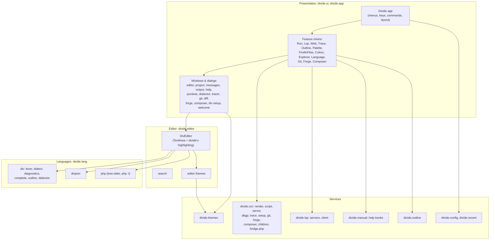
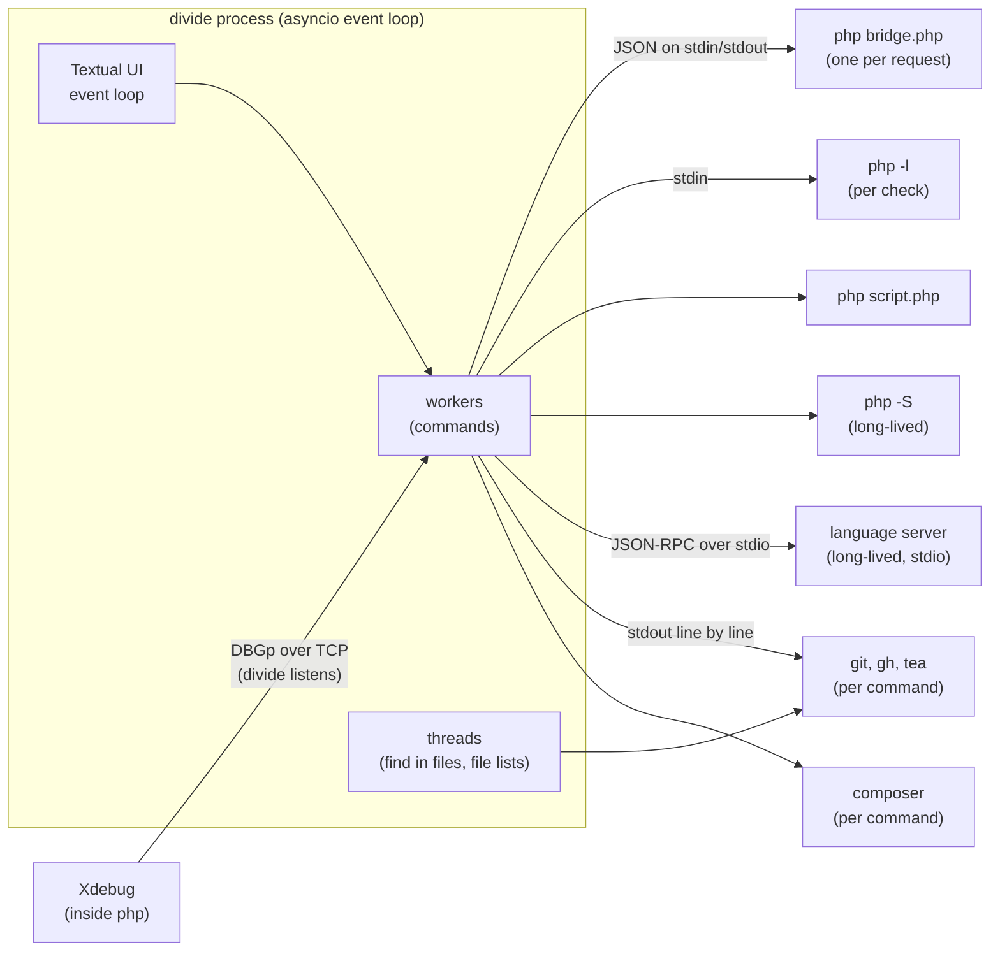
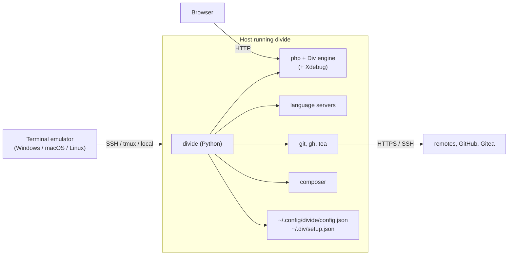

# Software Architecture Document

## 1. Introduction

This document describes divide's architecture through RUP's **4+1 views**:
use-case, logical, process, implementation and deployment views, plus a data
view. It records the decisions that shape the code and the reasons for them.
The class-level detail is in the [design model](design-model.md).

divide is an IDE for developing generators with the Divengine ecosystem
(see the [vision](vision.md)). This document describes the IDE: where
generator projects are written, configured, checked, rendered, traced and
debugged. A generator is a separate project, deployed and run without
divide, so its architecture is not described here. Which responsibilities
around orchestration and generator interfaces (CLI, API, MCP) might belong in
the IDE has not been decided; section 11 records only what the current
architecture already offers.

## 2. Architectural goals and constraints

- **Div decides, divide asks.** Anything Div decides is asked of Div through
  one PHP bridge. That keeps divide correct across Div versions and
  dialects.
- **UI-independent core.** Language logic (lexing, checks, completion,
  outline, Div JSON, search) and the runners (render, script, server, DBGp,
  trace) do not import the UI. They are pure Python with plain data in and
  out, testable without a terminal.
- **Turbo Vision on Textual.** The look and the command model come from
  textual-vision. divide adds what it lacks (shadows, frame scroll bars,
  histories, menus that open on F10) without forking it.
- **Never block the event loop.** External tools run as asyncio
  subprocesses, file searches in threads, and slow checks are debounced.
- **Extensible by data.** Languages (`divide.lang.LANGUAGES`), help books
  (`manual/books.json`), colour themes (`themes.THEMES`) and language servers
  (`lsp.SERVERS`) are tables.

## 3. Use-case view

The architecturally significant use cases (see the [use-case model](use-case-model.md)) are:

| Use case | Why it is significant |
|---|---|
| UC2 Edit a Div template | Exercises the lexer, the dialect resolution and the editor integration (highlight map, incremental cache). |
| UC3 Check a template / UC4 Render | Exercises the bridge, background workers, the Messages window and the progress box. |
| UC5 Trace a render | Needs a deeper conversation with Div (traced render) and its own window. |
| UC11 Debug PHP / UC12 Web server | Long-lived external processes, a socket protocol (DBGp) and UI state that follows them. |
| UC9 Edit PHP with a language server | A long-lived JSON-RPC server per language, synchronised on every edit. |
| UC13 Find files, text and commands | Project-wide work that must stay bounded in time and memory. |
| UC16 Work with git / UC17 Pull requests | Every change made by external programs (`git`, `gh`, `tea`) that can never ask a question, their output streamed line by line, and state (marks, margin) refreshed as files change. |
| UC1 Open and navigate a project | The project folder is optional: everything that walks the project must work, or offer to open one, with no folder. |

## 4. Logical view

divide is layered. Upper layers depend on lower ones, never the reverse.



| Package | Responsibility |
|---|---|
| `divide.app` | The `Divide` application: menu bar, status line, key bindings, the command dispatcher (`run_command`), window layout, the glue between editors and services. It is composed from the feature mixins. |
| `divide.ui` | Turbo Vision windows, dialogs and lists. One module per feature area, usually a window or dialog plus a mixin that adds the feature to the app. |
| `divide.editor` | `DivEditor`, the text editor (Textual's TextArea with divide's highlighting for Div and Div JSON, tree-sitter for PHP), plus find/replace and the editor colour themes. |
| `divide.lang` | The languages: which files they own, and their lexers, checkers, completion and outline. UI-independent. `treesitter`: the grammars of the other files of a project (HTML, CSS, JavaScript, Markdown, SQL, XML, YAML, TOML, shell); `plain`: INI and CSV. |
| `divide.run` | Everything that runs an external program: render and resolve through the bridge, scripts, the web server, the DBGp debugger, the render trace, the Div setup (`setup`), git (`git`), the forges (`forge`, through `gh` and `tea`), Composer (`composer`), and the guard that no child outlives divide (`children`). UI-independent. |
| `divide.outline` | The outline of every language divide colours, as trees of `Node`s (one builder per family: PHP, Div, markup, code, data). Search > Outline and the project window's file members use it. UI-independent. |
| `divide.lsp` | The known language servers and the LSP client (pygls). |
| `divide.manual` | The help books: Markdown pages to help topics; `fulltext`: their search index (SQLite FTS5). |
| `divide.themes` | Every colour divide draws, as palettes with roles. |
| `divide.config` | The settings file. |
| `divide.recent` | The folders and files opened lately (the config's `recent`), for the Welcome window. |
| `divide.i18n` | The interface's language: gettext catalogues in `locale/`, `_()` and `ngettext()`. |

### 4.1 Key mechanisms

- **Command dispatch.** Menus, the status line, key bindings and the command
  palette all post a `CommandMessage(command, info)`. `Divide.run_command`
  matches it and calls the feature. A new feature adds a `CM_*` constant, a
  menu item, perhaps a binding, and a case.
- **Highlighting.** `DivEditor` replaces TextArea's tree-sitter highlight map
  builder with divide's lexers for Div and Div JSON. The lexer output is
  cached per text and dialect. PHP keeps tree-sitter. Token kinds map to
  syntax roles in `themes.TOKENS`, and each palette colours the roles.
- **Theming.** A `Palette` produces a Textual theme with `$divide-<role>`
  CSS variables, plus the editor TextArea themes. Switching themes refreshes
  every widget. On 16-colour terminals every colour snaps to its ANSI slot.
- **Views over a buffer.** The data tree and the dialector never own data.
  They parse the editor's text and write their edits back as text edits.
- **An optional project.** `Divide.folder` is the folder given or opened, or
  `None`. `Divide.root` is where relative work happens: the folder, else the
  active file's folder. Features that need a project (the project window, Find
  in files, the project's Div setup) check `folder` and offer File > Open
  folder when there is none; Go to file lists no files, and git works on the
  repository of `root`. Opening another folder closes the windows of the
  last one and stops its language servers, debug session and web server.
- **External programs that never ask.** git, `gh`, `tea` and Composer run
  with their prompts off (`GIT_TERMINAL_PROMPT=0`, no terminal; on Linux and
  macOS in a session of their own, so ssh cannot ask for a passphrase on
  divide's screen). Their output reaches the progress box line by line, and a
  failure is shown in their own words.
- **Background work.** Textual workers (`@work`) run commands. Subprocesses
  use asyncio. CPU-bound project searches use `asyncio.to_thread`. Debounce
  timers (0.25-0.5 s) delay include resolution, `php -l`, LSP sync and
  dialect checks until typing pauses.

## 5. Process view



- The UI thread runs Textual's event loop. Commands run as workers on the
  same loop, so their awaits never freeze the screen.
- The **bridge** is a one-shot PHP process per request: render, resolve,
  `dialect_validate`, `dialect_load`, `trace` or `translate`. Being
  stateless, it always sees the files and the engine as they are now.
- **Language servers** are long-lived, one per language and project,
  started when the first file of their language opens and stopped on exit.
- **Debugging**: divide listens on a free local port. Xdebug, inside the PHP
  process of the script or of `php -S`, connects back. `DebugSession` drives
  it.
- No child outlives divide (`run.children`): on Linux the kernel ends each
  one when divide dies (`PR_SET_PDEATHSIG`), and the ones still running are
  killed when the app closes, however it ends.

## 6. Implementation view

```
src/divide/
  app.py               the application, commands, layout
  config.py            settings file
  recent.py            recent folders and files
  themes.py            colour palettes and roles
  glyphs.py            the characters divide may draw
  editor/              DivEditor, search, editor themes
  lang/                languages: __init__ (table), php.py, divjson.py
    div/               lexer, dialect, diagnostics, complete, outline, dialector, preview
  outline/             outlines: php, div, markup, code, data
  run/                 render.py, script.py, server.py, dbgp.py, trace.py, setup.py,
                       git.py, forge.py, composer.py, children.py, bridge.php
  lsp/                 server table, client
  manual/              help engine, books.json, books/<id>/ and books/<id>.<lang>/ (copied pages)
  locale/              gettext catalogues (divide.pot, <lang>/LC_MESSAGES/divide.po, .mo)
  ui/                  windows, dialogs, one module per feature
tests/                 pytest (+ pytest-asyncio), one file per area
tools/                 install.sh, sync_book.py, i18n.py, wiki_shots.py, screencast.py
packaging/             the standalone binary (PyInstaller), Linux packages, AppImage, MSI,
                       the Homebrew, Scoop and winget manifests, MSIX
releases/              VERSION's notes: one per version
.github/workflows/     tests.yml (Linux, macOS, Windows), release.yml
docs/                  this documentation
```

Dependencies are declared in `pyproject.toml`: textual, textual-vision
(pinned), tree-sitter with the grammars of PHP and the other file types, and
pygls, plus pytest, pytest-asyncio and Babel for development. The version is
the one line of `VERSION`. The console entry point is `divide =
divide.app:main`.

## 7. Deployment view



The terminal emulator may be on another machine, so fonts and key encodings
are not under divide's control. This is why divide sticks to ASCII and CP437
glyphs, and why no command depends on a Ctrl+Shift combination (Windows
Terminal keeps Ctrl+Shift+P and Ctrl+Shift+F for itself). See
[deployment.md](deployment.md) for installation and configuration.

## 8. Data view

divide has no database. Its persistent data:

| Data | Where | Owner |
|---|---|---|
| Settings: palette, colours, icons, Div engine, Xdebug, LSP choices and commands, run arguments, web server, Composer, input histories, the diff's layout, recent folders and files | `$XDG_CONFIG_HOME/divide/config.json` | `divide.config` and the feature that uses each key |
| Div setup of a project, of the user | `<project>/.div/setup.json`, `~/.div/setup.json` (`$DIV_HOME`) | the developer, through Options > Div setup (`divide.run.setup`) |
| Trusted PHP settings of projects | `~/.div/trust.json` (a hash per setup file) | `divide.run.setup` |
| Language server caches | `$XDG_CACHE_HOME/...` | `divide.lsp.client` |
| Help books | `src/divide/manual/books/<id>/` (packaged) | `tools/sync_book.py` |
| Help search index | `src/divide/manual/search.sqlite`, `search.<lang>.sqlite` per language of the books (packaged; rebuilt in memory when stale) | `tools/sync_book.py` → `divide.manual.fulltext.build` |
| Projects' files | the project folder | the developer; divide only reads and writes what is edited. The repository and `composer.json` are changed only by git and Composer. |

## 9. Size and performance

About 26,000 lines of Python in 74 modules, plus one PHP bridge, with about
360 tests in 46 files, run on Linux, macOS and Windows. The design targets small virtual machines: on-demand
processes, bounded searches, and an incremental lexer cache. See the
[supplementary specification](supplementary-specification.md).

## 10. Quality decisions

| Decision | Alternatives considered | Reason |
|---|---|---|
| A PHP bridge instead of a Python Div | Port Div's rules to Python | Div's behaviour (fixed point, dialects, includes, jsonDecode) would drift. Asking Div is always right. |
| Own Div lexer (no tree-sitter grammar) | A tree-sitter grammar | Dialects change the tags at runtime, and Div matches blocks by key and balance, which a static grammar cannot express. |
| textual-vision | Plain Textual widgets, or curses | The Borland look and command model come ready-made, and Textual gives testing (pilot), CSS and Unicode handling. |
| Mixins on the app | A plug-in registry | Each feature needs the app's windows, dialogs and commands. Mixins keep each feature in one module with no extra indirection. |
| Own fuzzy matcher | Textual's `FuzzySearch` | Textual's matcher enumerates every placement of the letters, which explodes on long paths and large projects. A linear matcher keeps memory and time bounded. |
| git's file list for project search | Walking the tree | It respects `.gitignore` and is fast. The tree walk with the project window's hidden folders is the fallback. |
| tree-sitter grammars with Textual's queries for the other files | Writing lexers; Pygments | The grammars are the packages of Textual's own `syntax` extra and Textual ships tuned highlight queries for them; their captures are renamed into divide's namespace (`ts.*`) so the palettes colour them by role, as PHP. Grammars load on first use and stay cached (a freed grammar crashes tree-sitter). INI and CSV have no grammar there and are a few lines of lexer each. |
| gettext for the interface's languages | Own JSON catalogues; Fluent | gettext is in the standard library, handles plurals, and every translation tool (Poedit, Weblate, Crowdin) reads its `.po` files. Babel is needed only to extract and compile, as a development tool. |
| The language chosen at start | Switching live | Many texts are module constants (titles, hints, theme names). Choosing at start keeps them simple values; Options > Language applies at the next start, like the colour depth. |
| SQLite FTS5 for the help search | A hand-written inverted index and ranking; an external search engine | FTS5 ships with Python's `sqlite3`: BM25 ranking, Porter stemming, prefix queries and snippets, with no dependency. |
| The help index built at sync time and shipped | Built at every start; built on the first search only | The books change only when synced, so the index is built once with them. A fingerprint of the pages detects a stale index, which is then rebuilt in memory (0.1 s), so results are never out of date. |
| Two FTS5 tables (stemmed and as written) | One stemmed table | A prefix of a stem is not a prefix of the word (*Iterations* is stored as `iter`, so `itera*` would miss it). Finished words match stems; the word being typed matches either table. |
| The system's `git` for everything | A Python git library (dulwich, pygit2) | The developer's own settings, hooks, credentials and signing keep working, and git's merges and machine formats (`status --porcelain=v2`, `for-each-ref`) are git's own. Nothing to bundle. |
| `gh` and `tea` for the forges | Calling GitHub's and Gitea's APIs | They are signed in as the developer already, and each speaks its forge; divide reads their JSON and needs no token of its own. |
| A folder only when it is given | Always the current folder | As VS Code: `divide` alone in the home folder would otherwise make it the project (its file list, its language servers); the Welcome window brings back the recent ones. |
| Standalone binaries (PyInstaller) for releases | Only `pip install` | Users get divide without Python, from Homebrew, Scoop, the MSI, Linux packages or the AppImage; one recipe builds them all on each platform's runner. |

## 11. Open questions (not designed)

Orchestration and interfaces such as a CLI, an HTTP API or an MCP server may
be implemented by generator projects; divide may offer tools to develop,
inspect or test them. How responsibilities are split between the IDE and
generator projects is not decided, and the abstraction model is still to be
specified. This document defines no execution graph, pipeline format or
interface. What the current architecture already offers, whatever is
decided:

- **A UI-independent core.** Rendering, tracing, dialect checks and
  translation (`divide.run`) take plain data and return plain data, without
  importing the UI, so tools of the IDE other than its windows could call
  them.
- **One bridge to Div.** Every question to Div goes through `bridge.php` as
  one JSON request and one JSON reply, with the project's Div setup applied.
  Another caller could ask Div the same way the editor does.
- **No hidden state in divide.** The bridge is one-shot and stateless, so
  divide adds nothing between requests. What a render depends on beyond its
  template, data, engine and setup (the time, random values, the request,
  PHP functions) is Div's; controlling it is the generator's concern.

