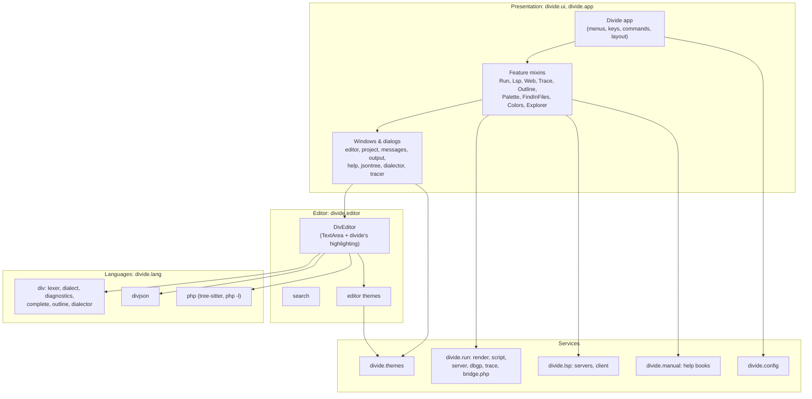
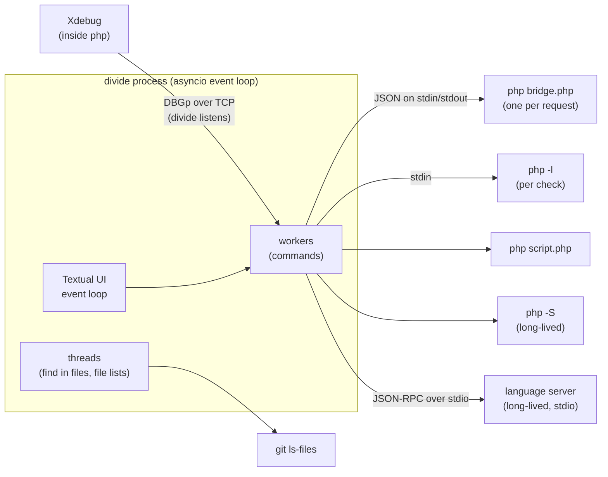
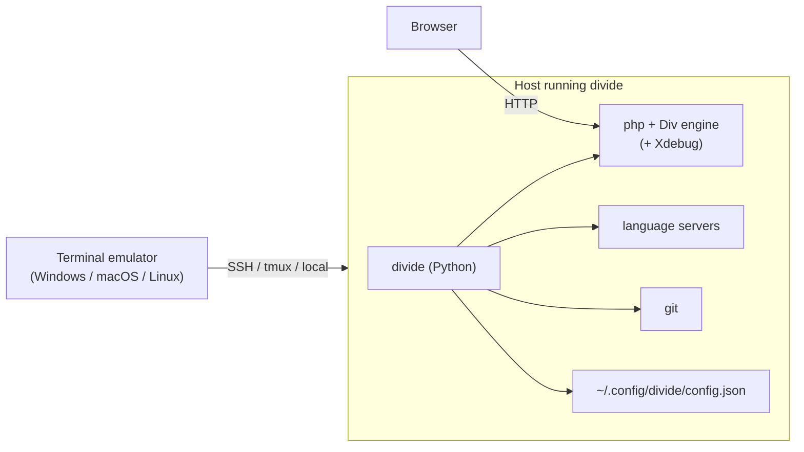

# Software Architecture Document

## 1. Introduction

This document describes divide's architecture through RUP's **4+1 views**:
use-case, logical, process, implementation and deployment views, plus a data
view. It records the decisions that shape the code and the reasons for them.
The class-level detail is in the [design model](design-model.md).

## 2. Architectural goals and constraints

- **Div decides, divide asks.** Anything Div decides is asked of Div through
  one PHP bridge. That keeps divide correct across Div versions and
  dialects.
- **UI-independent core.** Language logic (lexing, checks, completion,
  outline, Div JSON, search) and the runners (render, script, server, DBGp,
  trace) do not import the UI. They are pure Python with plain data in and
  out, testable without a terminal.
- **Turbo Vision on Textual.** The look and the command model come from
  textual-vision. divide adds what it lacks (shadows, frame scroll bars,
  histories, menus that open on F10) without forking it.
- **Never block the event loop.** External tools run as asyncio
  subprocesses, file searches in threads, and slow checks are debounced.
- **Extensible by data.** Languages (`divide.lang.LANGUAGES`), help books
  (`manual/books.json`), colour themes (`themes.THEMES`) and language servers
  (`lsp.SERVERS`) are tables.

## 3. Use-case view

The architecturally significant use cases (see the [use-case model](use-case-model.md)) are:

| Use case | Why it is significant |
|---|---|
| UC2 Edit a Div template | Exercises the lexer, the dialect resolution and the editor integration (highlight map, incremental cache). |
| UC3 Check a template / UC4 Render | Exercises the bridge, background workers, the Messages window and the progress box. |
| UC5 Trace a render | Needs a deeper conversation with Div (traced render) and its own window. |
| UC11 Debug PHP / UC12 Web server | Long-lived external processes, a socket protocol (DBGp) and UI state that follows them. |
| UC9 Edit PHP with a language server | A long-lived JSON-RPC server per language, synchronised on every edit. |
| UC13 Find files, text and commands | Project-wide work that must stay bounded in time and memory. |

## 4. Logical view

divide is layered. Upper layers depend on lower ones, never the reverse.



| Package | Responsibility |
|---|---|
| `divide.app` | The `Divide` application: menu bar, status line, key bindings, the command dispatcher (`run_command`), window layout, the glue between editors and services. It is composed from the feature mixins. |
| `divide.ui` | Turbo Vision windows, dialogs and lists. One module per feature area, usually a window or dialog plus a mixin that adds the feature to the app. |
| `divide.editor` | `DivEditor`, the text editor (Textual's TextArea with divide's highlighting for Div and Div JSON, tree-sitter for PHP), plus find/replace and the editor colour themes. |
| `divide.lang` | The languages: which files they own, and their lexers, checkers, completion and outline. UI-independent. |
| `divide.run` | Everything that runs PHP: render and resolve through the bridge, scripts, the web server, the DBGp debugger and the render trace. UI-independent. |
| `divide.lsp` | The known language servers and the LSP client (pygls). |
| `divide.manual` | The help books: Markdown pages to help topics. |
| `divide.themes` | Every colour divide draws, as palettes with roles. |
| `divide.config` | The settings file. |

### 4.1 Key mechanisms

- **Command dispatch.** Menus, the status line, key bindings and the command
  palette all post a `CommandMessage(command, info)`. `Divide.run_command`
  matches it and calls the feature. A new feature adds a `CM_*` constant, a
  menu item, perhaps a binding, and a case.
- **Highlighting.** `DivEditor` replaces TextArea's tree-sitter highlight map
  builder with divide's lexers for Div and Div JSON. The lexer output is
  cached per text and dialect. PHP keeps tree-sitter. Token kinds map to
  syntax roles in `themes.TOKENS`, and each palette colours the roles.
- **Theming.** A `Palette` produces a Textual theme with `$divide-<role>`
  CSS variables, plus the editor TextArea themes. Switching themes refreshes
  every widget. On 16-colour terminals every colour snaps to its ANSI slot.
- **Views over a buffer.** The data tree and the dialector never own data.
  They parse the editor's text and write their edits back as text edits.
- **Background work.** Textual workers (`@work`) run commands. Subprocesses
  use asyncio. CPU-bound project searches use `asyncio.to_thread`. Debounce
  timers (0.25-0.5 s) delay include resolution, `php -l`, LSP sync and
  dialect checks until typing pauses.

## 5. Process view



- The UI thread runs Textual's event loop. Commands run as workers on the
  same loop, so their awaits never freeze the screen.
- The **bridge** is a one-shot PHP process per request: render, resolve,
  `dialect_validate`, `dialect_load`, `trace` or `translate`. Being
  stateless, it always sees the files and the engine as they are now.
- **Language servers** are long-lived, one per language and project,
  started when the first file of their language opens and stopped on exit.
- **Debugging**: divide listens on a free local port. Xdebug, inside the PHP
  process of the script or of `php -S`, connects back. `DebugSession` drives
  it.
- Processes are stopped when divide exits (`QUIT` stops LSP, the debug
  session and the web server).

## 6. Implementation view

```
src/divide/
  app.py               the application, commands, layout
  config.py            settings file
  themes.py            colour palettes and roles
  glyphs.py            the characters divide may draw
  editor/              DivEditor, search, editor themes
  lang/                languages: __init__ (table), php.py, divjson.py
    div/               lexer, dialect, diagnostics, complete, outline, dialector, preview
  run/                 render.py, script.py, server.py, dbgp.py, trace.py, bridge.php
  lsp/                 server table, client
  manual/              help engine, books.json, books/<id>/ (copied pages)
  ui/                  windows, dialogs, one module per feature
tests/                 pytest (+ pytest-asyncio), one file per area
tools/                 install.sh, sync_book.py, wiki_shots.py
docs/                  this documentation
```

Dependencies are declared in `pyproject.toml`: textual, textual-vision
(pinned), tree-sitter, tree-sitter-php and pygls, plus pytest and
pytest-asyncio for development. The console entry point is `divide =
divide.app:main`.

## 7. Deployment view



The terminal emulator may be on another machine, so fonts and key encodings
are not under divide's control. This is why divide sticks to ASCII and CP437
glyphs, and why no command depends on a Ctrl+Shift combination (Windows
Terminal keeps Ctrl+Shift+P and Ctrl+Shift+F for itself). See
[deployment.md](deployment.md) for installation and configuration.

## 8. Data view

divide has no database. Its persistent data:

| Data | Where | Owner |
|---|---|---|
| Settings: palette, colours, icons, Div engine, Xdebug, LSP choices and commands, run arguments, web server, input histories | `$XDG_CONFIG_HOME/divide/config.json` | `divide.config` and the feature that uses each key |
| Language server caches | `$XDG_CACHE_HOME/...` | `divide.lsp.client` |
| Help books | `src/divide/manual/books/<id>/` (packaged) | `tools/sync_book.py` |
| Projects' files | the project folder | the developer; divide only reads and writes what is edited |

## 9. Size and performance

About 15,000 lines of Python in 50 modules, plus one PHP bridge, with 180
tests in 29 files. The design targets small virtual machines: on-demand
processes, bounded searches, and an incremental lexer cache. See the
[supplementary specification](supplementary-specification.md).

## 10. Quality decisions

| Decision | Alternatives considered | Reason |
|---|---|---|
| A PHP bridge instead of a Python Div | Port Div's rules to Python | Div's behaviour (fixed point, dialects, includes, jsonDecode) would drift. Asking Div is always right. |
| Own Div lexer (no tree-sitter grammar) | A tree-sitter grammar | Dialects change the tags at runtime, and Div matches blocks by key and balance, which a static grammar cannot express. |
| textual-vision | Plain Textual widgets, or curses | The Borland look and command model come ready-made, and Textual gives testing (pilot), CSS and Unicode handling. |
| Mixins on the app | A plug-in registry | Each feature needs the app's windows, dialogs and commands. Mixins keep each feature in one module with no extra indirection. |
| Own fuzzy matcher | Textual's `FuzzySearch` | Textual's matcher enumerates every placement of the letters, which explodes on long paths and large projects. A linear matcher keeps memory and time bounded. |
| git's file list for project search | Walking the tree | It respects `.gitignore` and is fast. The tree walk with the project window's hidden folders is the fallback. |
