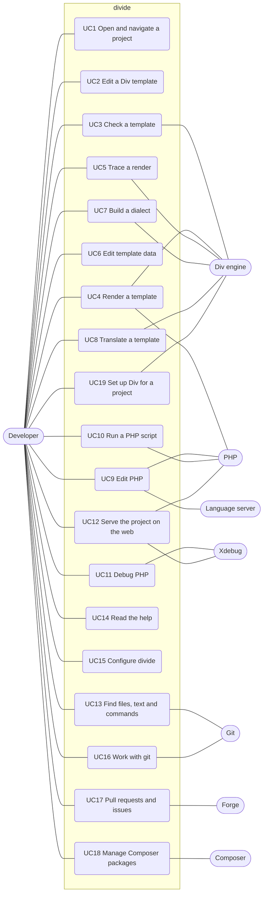

# Use-Case Model

The use cases describe what divide, the IDE, does today: the tools for
developing and debugging generator projects. Running a deployed generator is
not a use case of divide. What the IDE may offer around orchestration and
generator interfaces is not decided (see the
[vision](vision.md#9-open-questions-not-decided)). The "template" of these
use cases is a generator's template, whatever it produces: source code,
configuration, data, HTML or another template.

## 1. Actors

| Actor | Kind | Description |
|---|---|---|
| **Developer** | primary, human | Builds generators: edits, checks, renders, traces and debugs templates, their data and the PHP around them, from the keyboard (or the mouse). |
| **Div engine** | secondary, system | The Div installation, reached through PHP and the bridge. It renders, resolves includes, decodes data, validates and loads dialects, traces and translates. |
| **PHP** | secondary, system | The `php` binary: `php -l` checks, scripts, `php -S`, and the host of Div. |
| **Xdebug** | secondary, system | Debugs PHP scripts and web requests over DBGp. |
| **Language server** | secondary, system | phpactor, intelephense...: completion, hover, definitions, diagnostics over LSP. |
| **Git** | secondary, system | The system's `git`: the project's file list for Go to file and Find in files, and every change of the Git menu (status, diff, commit, log, branches, merge, stash, blame, pull, push). |
| **Forge** | secondary, system | GitHub through `gh`, Gitea (Forgejo, Codeberg) through `tea`, signed in as the developer: pull requests and issues. |
| **Composer** | secondary, system | Adds, removes, updates and installs the project's PHP packages; Packagist is searched for new ones. |
| **Browser** | secondary, system | Shows the pages of the built-in web server. |

## 2. Use-case diagram

## 3. Use-case specifications

Each specification gives the main flow and the main alternatives. The keys
and screens are described in the [manual](https://github.com/divengine/divide/wiki).
This document describes behaviour and responsibilities.

### UC1 Open and navigate a project

**Goal:** work on the files of one folder, or on a file alone.
**Trigger:** `divide [folder] [files...]`.
1. A folder is opened only when it is given (`divide .`, `divide ~/site`), as VS Code does: it becomes the project, and divide opens the given files in editor windows, or the project window if no file is given. Files alone (`divide page.tpl`) open with no folder. With nothing, divide shows the **Welcome window**: start (a new file, open a file, open a folder, the help) and the recent folders and files, newest first.
2. File > Open folder makes another folder the project: the windows of the last one close, asking about unsaved changes. File > Close folder goes back to no folder and the Welcome window (Help > Welcome shows it again).
3. The developer opens files from the project window (Enter or a double click), File > Open (F3, with the name history) or Go to file (UC13).
4. Windows are moved, resized, zoomed (F5), tiled, cascaded, cycled (F6) and closed (Alt+F3). Unsaved changes are asked about before closing or quitting.
- *Alt:* the project window creates, renames, deletes, cuts, copies, pastes and moves files and folders (Ins, F7, F2, Del, Ctrl+X, Ctrl+C, Ctrl+V, a drag, local menu), and unfolds a file into its members (its outline).
- *Alt:* with no folder, Ctrl+B, Find in files and the project's Div setup offer to open one.
- *Alt:* Del on a recent folder or file of the Welcome window takes it off its list.

### UC2 Edit a Div template

**Goal:** write a template with Div's structure visible.
1. The editor highlights the template with the lexer built from its dialect (`@_DIALECT`, resolved like Div does).
2. As the developer types, completion offers variables from the data file, loop item fields, includes and snippets (Ctrl+Space).
3. Ctrl+Enter opens the included template under the cursor, as resolved by Div.
4. Search > Outline lists the template's constructs, nested, and follows the edits.
- *Alt:* an unknown dialect keeps the default tags and says so in the status line.

### UC3 Check a template

**Goal:** see errors before rendering.
1. While the developer types, the static checker reports unclosed or orphan blocks, conditions without a closer, broken JSON in definitions, and tags Div would leave as text.
2. Includes are resolved by Div in the background, and the unresolvable ones are reported.
3. Alt+F9 runs the check under the progress box. The Messages window lists the results and Alt+F8 / Alt+F7 walk through them.

### UC4 Render a template

**Goal:** see the output Div produces from a template and its data.
1. Ctrl+F9 sends the editor's text (unsaved edits included), its real path and its data file to the bridge.
2. Div renders it. The Output window shows the result next to the code, and warnings and fatal errors go to the Messages window.
- *Alt:* no engine is found, so divide asks for one (Options > Div engine).
- *Alt:* Esc in the progress box stops the render.

### UC5 Trace a render

**Goal:** understand how the output came to be.
1. Debug > Render trace (F7 in a template) asks the bridge for a traced render.
2. The trace window lists Div's mutations in order. Each one shows the template before and after, and where in the source it happened.

### UC6 Edit template data

**Goal:** prepare the data a template is rendered with.
1. The data file opens as Div JSON, highlighted and validated.
2. Ctrl+T switches to a tree editor over the same buffer. Its edits are text edits, so undo, save and the dirty flag work as usual.
- *Alt:* Run > Data file chooses another data file for the template.

### UC7 Build a dialect

**Goal:** a valid `.dialect` file.
1. Tools > Dialector shows the dialect's tags by section, each with an example rendered in that dialect.
2. Each change is validated by Div (`isValidCurrentDialect`) and the verdict is shown.
3. The dialect can be imported from PHP `define()`s, checked against an example and saved.

### UC8 Translate a template

**Goal:** move a template from one dialect to another.
1. Tools > Translate asks for the template, the source dialect and the target dialect.
2. Div's `translate()` produces the result, which is previewed and then saved or opened.

### UC9b Edit the other files of a project

1. HTML, CSS, JavaScript, Markdown, SQL, XML (also `phpunit.xml.dist`, SVG), YAML, TOML, shell scripts and `.env`, INI (`php.ini`) and CSV files open highlighted in the palette's colours; the status line names the language.
- *Alt:* a grammar package is missing, so the file opens as plain text.

### UC9 Edit PHP

**Goal:** write the PHP around the templates.
1. tree-sitter's PHP grammar highlights the file. `php -l` checks it as the developer types.
2. A language server, if one is installed, adds completion, signatures, hover (Ctrl+F1), definitions (Ctrl+click) and its own diagnostics.
3. The outline lists namespaces, classes, members and functions.

### UC10 Run a PHP script

1. Ctrl+F9 runs the script with its parameters (Run > Parameters) under the progress box.
2. Its output goes to the Output window and PHP's errors to the Messages window, located.
- *Alt:* Run in terminal runs it outside divide, for interactive scripts.

### UC11 Debug PHP

1. With Xdebug available, F7 / F8 / F4 start the script under the debugger. Ctrl+F8 toggles breakpoints.
2. When the script pauses, the current line is shown, along with Watches, the Call stack and Evaluate (Ctrl+F4).
3. F7 traces into, F8 steps over, Shift+F8 steps out, Ctrl+F9 goes on and Ctrl+F2 resets.

### UC12 Serve the project on the web

1. Run > Web server starts `php -S` on the project, with a router if one is given. Its log goes to a window.
2. With Xdebug, each request pauses at the first breakpoint and is debugged as in UC11 while the browser waits.

### UC13 Find files, text and commands

1. **Go to file** (Ctrl+P): the developer types a few letters and the project's files are matched fuzzily. Enter opens the chosen file.
2. **Command palette** (Alt+P, or `>` in Go to file): every menu entry is matched the same way. Enter runs it.
3. **Find / Replace** (Ctrl+F / Ctrl+R) work in the current file. **Find in files** (Shift+F2) searches every project file, or those matching a mask, and lists the matching lines. Enter opens each one with the match selected.

### UC14 Read the help

1. F1 opens the topic for the active window. Contents, Index and Topic search browse the books (divide, Div).
2. Links between topics are followed with Enter, Alt+F1 goes back, and web links open in the browser.
3. **Help > Search** finds sections of every book by words, ranked. As the developer types, the matching sections are listed best first, each with the sentence where the words are. Enter opens the help at that section.
- *Alt:* Ctrl+F1 on a word that names no topic opens Help > Search with that word.
- *Alt:* the shipped index does not match the books (copied by hand), so it is rebuilt in memory on the first search.

### UC15 Configure divide

1. Options > Colors chooses the theme, previewed live, and the colour depth.
2. Options > Language servers, Div engine and Xdebug set the external tools. Options > File type marks changes the project tree.
3. Settings, histories and choices are kept in `config.json` (see [deployment.md](deployment.md)).

### UC16 Work with git

**Goal:** see, review and record the project's changes without leaving the editor.
1. In a git repository, the project window puts git's letter after each changed file and `•` after the folders holding changes, and dims what `.gitignore` leaves out; the editor's margin marks the lines added, changed or removed since the last commit, as the developer types.
2. Git > Changes lists the files in their areas (conflicts, staged, changes, untracked) with the focused one's diff. Space stages or unstages, Del discards, Ctrl+K commits (amend, stage everything first).
3. Git > History shows every branch as a graph and each commit's details and diff; File history, the commits of one file; Blame, each line with the commit that last changed it.
4. Git > Branches switches, creates, deletes and merges into the current branch, and brings back or applies the stashes. Pull, push and fetch run under the progress box with git's own words.
- *Alt:* a merge stops on conflicts: Git > Changes shows git's markers, our side and theirs, and Space marks a file solved.
- *Alt:* a remote needs a password or a passphrase: git cannot ask (there is no terminal for it), so it fails and says so.

### UC17 Pull requests and issues

1. Git > Pull requests and issues lists the open ones of the remote's repository (`origin`, else the first), with the one under the bar beside them.
2. Ins makes a new pull request of the current branch (pushed first if needed) or a new issue; Alt+F10 checks out a pull request, merges it on the forge or copies its address; Enter opens it in the browser.
- *Alt:* `gh` or `tea` is missing or not signed in: the window says what to install or run.

### UC18 Manage Composer packages

1. Tools > Composer packages lists what `composer.json` requires, the development packages, the dependencies installed with them and the platform, with the installed versions.
2. Ins adds a package (Packagist searched as the developer types, the newest stable version suggested), Del removes one, and update and install run Composer under the progress box, its output in the Composer window.
- *Alt:* no `composer.json`: a wizard writes one, as `composer init` would.

### UC19 Set up Div for a project

1. Options > Div setup edits `.div/setup.json` of the project (or the user's `~/.div/setup.json`) section by section: the engine, paths, file extensions, parser limits, dialect, data (globals, defaults, system variables), PHP functions and modifiers, the request's superglobals. The bridge applies it to every request, so renders, checks and completion see Div set up as the developer describes it. It is divide's design-time setup: the application's own runtime configuration of Div is its code's, and divide neither reads nor changes it.
2. Beside each section, what is in effect and where it comes from (the project, the user, Div's default); Div checks the saved setup and gives its verdict.
- *Alt:* a project's `php` section lets templates call PHP functions, so it is applied only once the developer trusts it (`~/.div/trust.json` keeps its hash; a change asks again).
