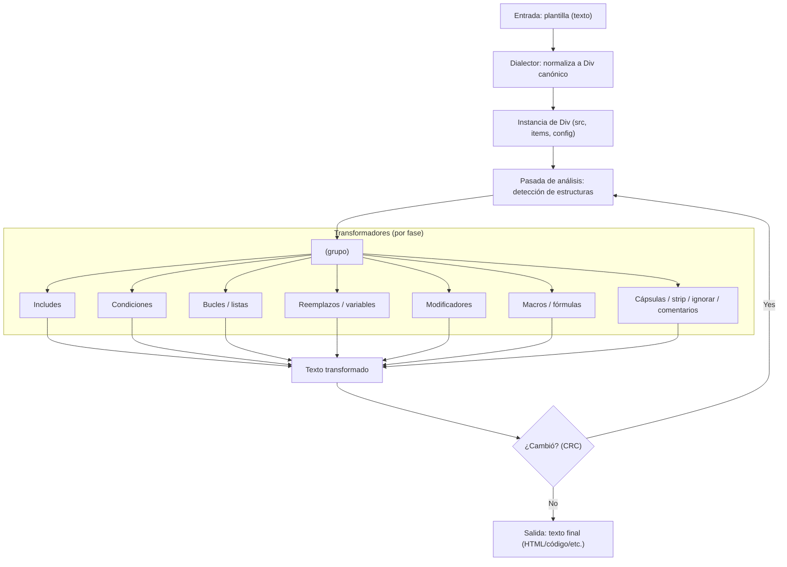
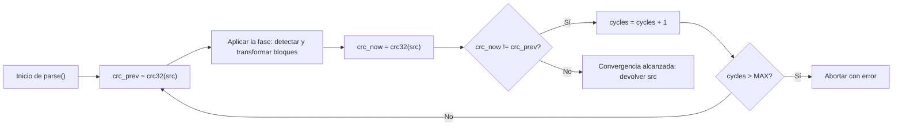
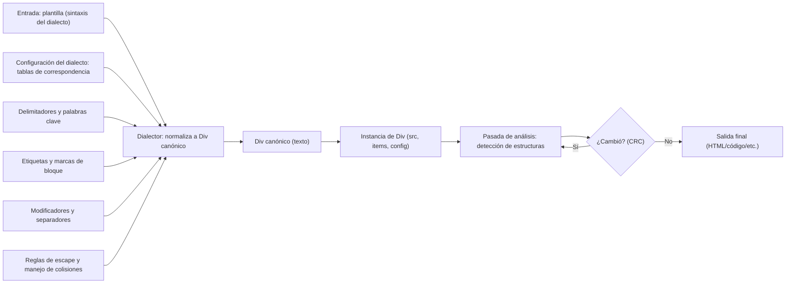
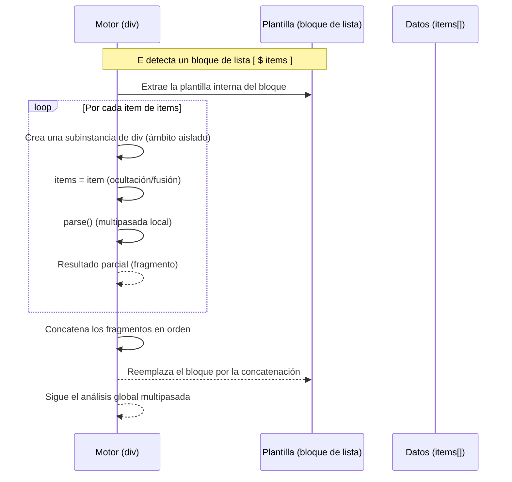

> [!WARNING]
> Esta documentación está actualmente en plena construcción.  
> El contenido puede estar incompleto, cambiar o reorganizarse a medida que evoluciona el motor Div.  
> Úsala con precaución y vuelve a consultarla con regularidad para ver las novedades.

# Visión general

Requisitos: PHP >= 8.0.

Div es un motor de plantillas y generador de código escrito en PHP. Está pensado para separar la presentación de los datos y del comportamiento, y para dar soporte a flujos de trabajo dirigidos por modelos y generativos. El motor puede adaptar su sintaxis mediante dialectos sin perder una representación interna canónica para el análisis y la transformación.

## Flujo de procesamiento



## Convergencia y recursión



## Dialectos



## Ámbito de los bucles y subinstancias



## Operaciones básicas

- Compilar: combinar una plantilla con un modelo y guardar el resultado.
- Transformar: convertir un modelo en otro reutilizando la compilación.
- Componer: ensamblar varias salidas en un artefacto final.

## Instalación

```bash
composer require divengine/div
```

## Actualización

```bash
composer upgrade
```

## Mapa de la documentación

- [[01 Introducción|01 Introduction]]
- [[02 Características de las plantillas|02 Template Features]]
- [[03 Características de PHP|03 PHP Features]]
- [[04 Mecanismos|04 Mechanisms]]
- [[05 Apéndices|05 Appendixes]]

Consulta también las [notas de versión](https://github.com/divengine/div/blob/master/releases/README.md).

#templates
